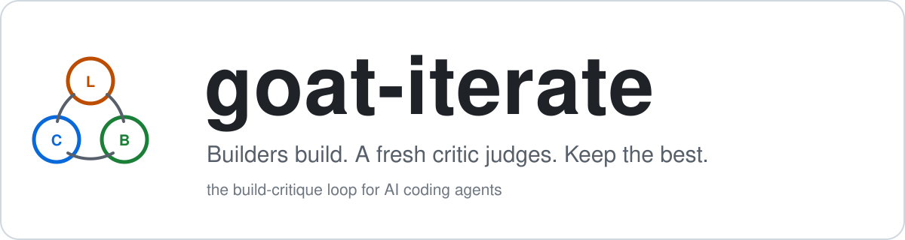
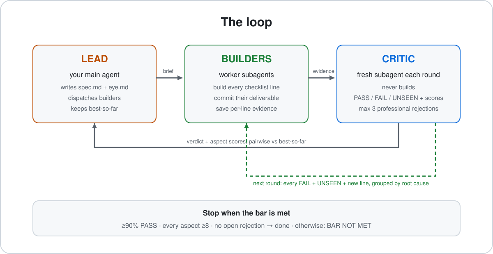

<p align="center">
  <picture>
    <source media="(prefers-color-scheme: dark)" srcset="assets/banner-dark.svg">
    
  </picture>
</p>

<h1 align="center">goat-iterate</h1>

<p align="center">
  
  
  
</p>

You ask your agent to build something. It builds it, says "done", and grades its own homework. goat-iterate splits the job across three roles, so the judge never wrote the code it scores:

- **Lead** (your main agent) keeps the bar, dispatches builders, owns best-so-far.
- **Builders** (worker subagents) produce the deliverable with per-line evidence.
- **Critic** (fresh subagent each round) judges from evidence, scores aspects 1-10, rejects like a professional reviewer.

<p align="center">
  <picture>
    <source media="(prefers-color-scheme: dark)" srcset="assets/loop-dark.svg">
    
  </picture>
</p>

## How a loop runs

1. **Round 0 - the bar.** Lead writes `spec.md` (what "done" means, observable) and `eye.md` (how the real output is observed). Critic setup mode writes `rubric.md` (5-8 aspects, top-professional descriptors) and `checklist.md` (15-30 pass/fail lines with numbers).
2. **Round 1 - full build.** Every checklist line built in one round, complete first version, parallel builders.
3. **Rounds 2..N - judge / keep / batch.** Fresh critic each round: PASS/FAIL/UNSEEN per line with evidence, aspect scores vs best-so-far, at most 3 professional rejections. Lead keeps what passed, batches every FAIL + new line into the next build round.
4. **Stop.** Bar met (>=90% PASS, every aspect >=8, no open rejection), plateau, or budget (4 judged rounds default). Every stop without the bar met writes `BAR NOT MET` at the top of the report. The word "done" appears only when the bar is met.

## Install

**Claude Code**, as two separate prompts:

```
/plugin marketplace add 1Rizqi/goat-iterate
```

```
/plugin install goat-iterate@goat-iterate
```

**Codex:**

```bash
codex plugin marketplace add 1Rizqi/goat-iterate
codex plugin add goat-iterate@goat-iterate
```

**Gemini CLI:**

```
gemini extensions install https://github.com/1Rizqi/goat-iterate
```

**Hermes Agent:**

```
hermes plugins install 1Rizqi/goat-iterate
hermes plugins enable goat-iterate
```

**Any other agent:**

```
npx skills add 1Rizqi/goat-iterate
```

or copy `skills/goat-iterate/` into the agent's skills directory.

## Use

Tell your agent "use goat-iterate for this". The loop folder `.iterate/<slug>/` holds the spec, rubric, checklist, per-round verdicts, evidence, and `state.md` (loop memory - a new chat resumes from it).

## What's in the box

```
plugin.json                                 Agent Plugins v1.0.0 manifest
skills/goat-iterate/SKILL.md                the skill: decision path, lead rules, delegation, rounds, stop conditions
skills/goat-iterate/references/eye.md       eye table by deliverable type (evidence beats source)
skills/goat-iterate/references/rounds.md    round-by-round detail incl. amend
skills/goat-iterate/references/spec-template.md
skills/goat-iterate/references/subagent.md  builder/critic rules for dispatch briefs
assets/banner-dark.svg / banner-light.svg   README banner, dark + light
assets/loop-dark.svg / loop-light.svg       the loop diagram, dark + light
LICENSE                                     MIT
```

## License

[MIT](LICENSE).
